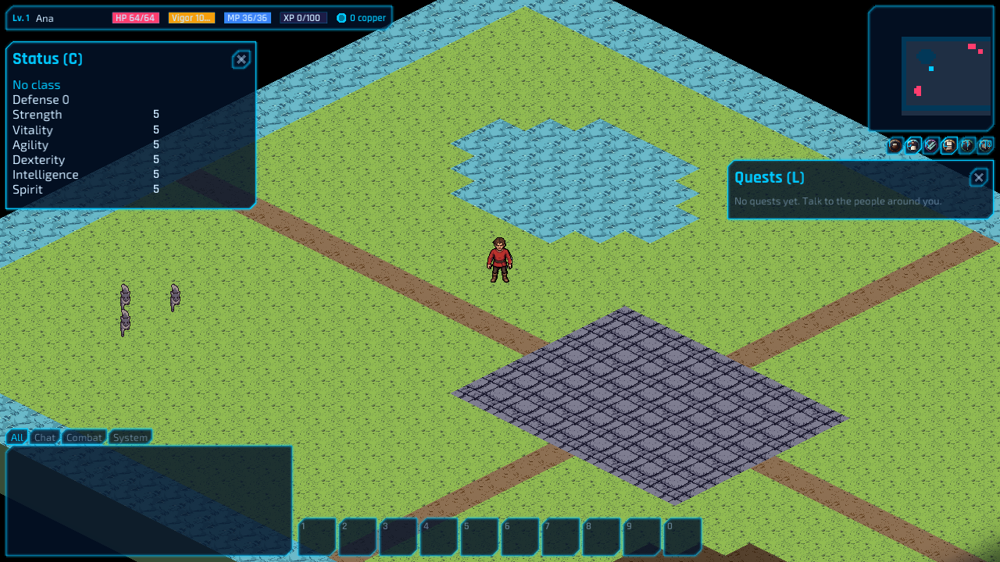
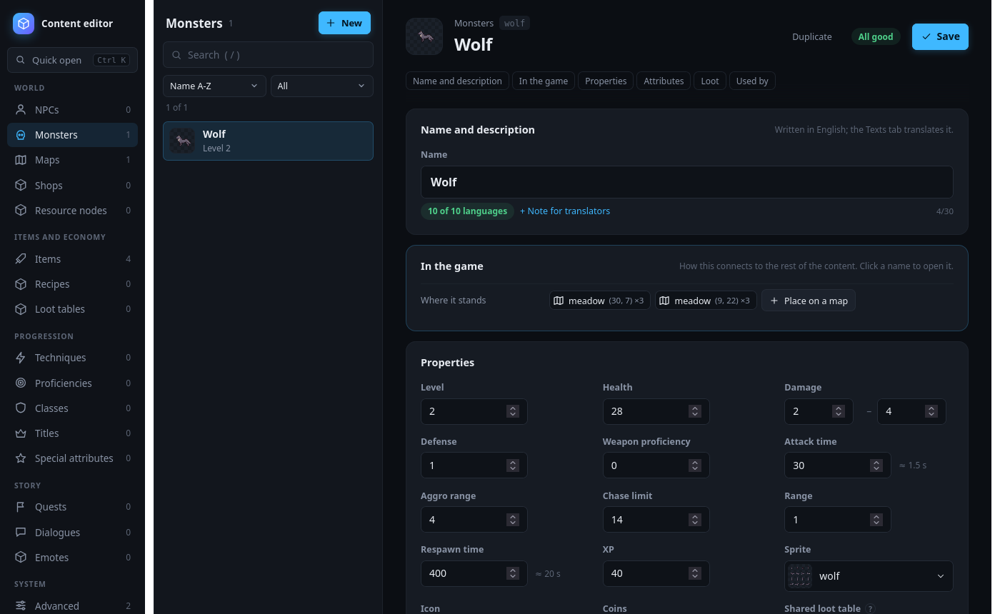

# MMO Kit

A kit for building 2D isometric, tile-based MMOs in Rust: an authoritative server, a client for Linux and Windows, a local web editor and tools. A game is a folder of data; nobody writes code to make one. MIT licensed ([LICENSE](LICENSE)).



| The editor: painting a map | Editing an item | Editing a monster |
|---|---|---|
|  |  |  |

## Try it in five steps

You need Rust ([rustup.rs](https://rustup.rs)); the version is pinned in `rust-toolchain.toml` and installs itself. The client needs a desktop session and a video driver (Vulkan, DirectX 12 or OpenGL).

**1. Build the kit** (from this folder; the first build takes several minutes):

```sh
cargo build --release
```

**2. Put the tools on your `PATH`, for every terminal** (Linux with bash; with zsh use `~/.zshrc`; run it once from this folder):

```sh
echo "export PATH=\"$PWD/target/release:\$PATH\"" >> ~/.bashrc
source ~/.bashrc
```

Now `server`, `client`, `editor`, `validate` and `admin` work in any new terminal.

**3. Make your game** from the template:

```sh
cp -r templates/new-game ~/mygame
```

**4. Play it.** Open two terminals, and in each one `cd ~/mygame` first:

```sh
server --dev                                      # terminal 1: wait for "server ready"
client --dev                                      # terminal 2: the game window opens
```

You appear on a stone plaza. Click to walk; wolves roam two corners of the meadow, and clicking one attacks it. `F1` shows every key. Close the window and press `Ctrl+C` in terminal 1 to stop; your character is saved.

**5. Change it.** With the server still running, in a third terminal:

```sh
cd ~/mygame
editor                                            # then open http://127.0.0.1:7878
```

Edit an item or a monster and save: the server reloads it within seconds, and the game shows the change.

## Next

- [Documentation](docs/README.md): start with [getting started](docs/getting-started.md) and [concepts](docs/concepts.md).
- [`examples/riftara/`](examples/riftara/README.md): a complete game made with the kit (not part of the kit).
- Contributing to the kit: `./ci.sh` must pass ([contributing](docs/contributing.md)).
