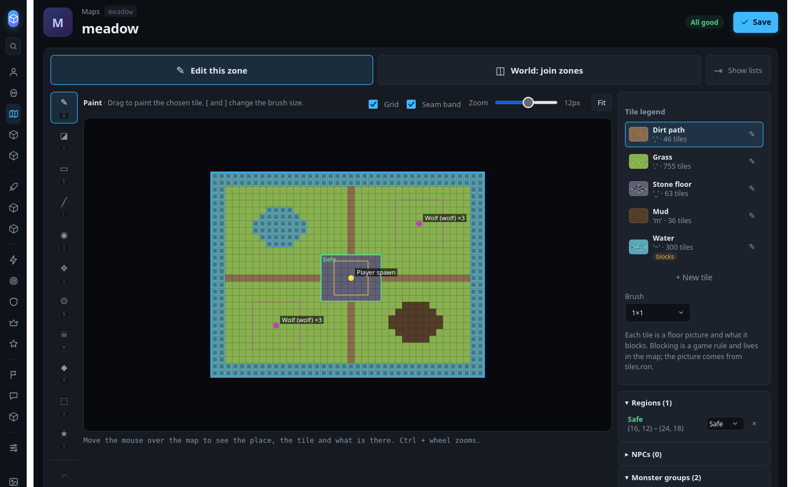
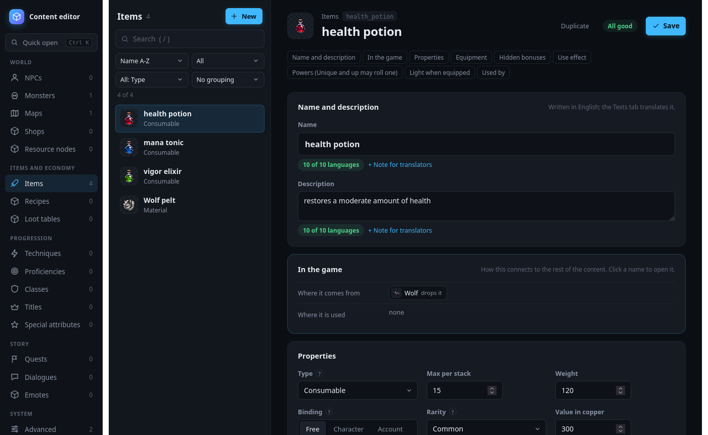

# MMO Kit

A kit for building 2D isometric, tile-based MMOs in Rust: an authoritative server, a client for Linux and Windows, a local web editor and tools. A game is a folder of data; nobody writes code to make one. MIT licensed ([LICENSE](LICENSE)).


| The editor: painting a map | Editing an item | Editing a monster |
|---|---|---|
|  |  |  |

## Why this kit

### Make a game without code

- **A visual editor for everything:** items, monsters, NPCs, dialogues, quests, shops, recipes, techniques, classes, titles, maps, art, sounds, themes and balance numbers. Forms are generated from the content types, references are pick lists, and mistakes show on the field as you type.
- **See changes live:** save in the editor and the running server reloads the content within seconds, without disconnecting anyone. Broken content is refused and the game keeps the last good version.
- **Maps and dialogues drawn, not typed:** paint tiles, place spawns and regions, join zones into one world; build conversations as a map of steps with conditions, effects and a clickable preview.
- **No scripting language to learn or to exploit:** behaviour comes from closed blocks (conditions, effects, objectives, rewards, bonuses) that are validated before they run.
- **Everything connected and checked:** each item shows where it comes from (which monster drops it, which shop sells it) and where it is used, one click away. The editor warns about an item with no source in the game, a text left untranslated, or missing art.
- **Look and sound included:** a theme screen changes the interface's colours and fonts without rebuilding; a sound screen binds sounds to events, techniques and zones, with each file's licence and credit.

### Ten languages, in the game and in the editor

- **Every text is a translation** from day one: English, Portuguese (Brazil), Chinese, Italian, Indonesian, German, Russian, Spanish, Japanese and Korean, each player choosing their own.
- **The editor itself speaks the same ten languages**, and every name and description shows how many languages it is translated into.
- **Languages are data:** adding one is a line in a file; plural and number rules cover about 30 languages; `validate` checks every placeholder, plural form and length limit.

### Built to hold a crowd

- **About 2000 players in a single zone** with every server tick under 41.7 ms (the tick of Astonia); 1000 players walking cost **4 ms** per tick, **~24 KB** of memory each, with a **22 ms** p99 round trip ([benchmarks](docs/performance.md)).
- **One open world, many processes:** zones are joined by seams with no loading screens, and run in one process or spread over many with no code change.
- **Crashes stay small:** a failing zone restarts on its own while the rest of the world keeps playing, and its recording replays tick by tick to the same state for debugging.
- **Light on the network:** each player receives only what changed since the last tick, and texts are cached by the client.
- **A queue instead of a wall:** when the world is full, new players wait in line and see their position and an estimate.

### Secure and reliable by design

- **The server decides everything** and sends each player only what they can see, so speed hacks and map hacks have nothing to work with.
- **Accounts protected** with TLS, argon2id passwords, brute-force defences and device tokens; **items can never be duplicated** (one owner per item, atomic saves); **no `unsafe` code** ([security](docs/security.md)).

### Run it as a live game

- **Economy telemetry:** coins created and destroyed per source, so inflation shows up before players feel it.
- **Bot hunting:** kills per hour and hours without a break per character, and a list of suspects for a human to review.
- **Moderation, economy and replays in the editor:** mute, suspend, ban, reports and a zone's recording with a timeline, with buttons; every action audited.
- **Ready for a public server:** hourly backups with an optional off-site copy, announced restarts with automatic reconnection to the same character, systemd units and login protection ([operations](docs/operations.md)).
- **Test tools included:** bots for load tests (walking, hunting and trading, crossing zones) and the replay tool.

### Polished for players

- **A living picture:** day and night, light from tiles, objects and worn items (a torch lights its holder), and fog outside sight.
- **Sound:** music per zone that fades in at the border, a sound per technique, positional effects, volume per channel.
- **Comfort:** rebindable keys, a hotbar the player arranges, screenshots with `F12`, and automatic reconnection after a drop.

### Easy to own

- **Pure Rust:** nothing to install but Rust; one server binary; a client for Linux and Windows.
- **Your game stays yours:** it lives in its own folder, apart from the kit, so the kit can be updated without touching it.
- **Art by name, with a safety net:** replace a picture by dropping a file with the same name and the client shows it within a second; missing art never blocks the game, a generic shape stands in.
- **Saves that survive updates:** character data is versioned and migrated, so a new version never breaks saved characters.
- **Guarded code:** CI checks that each part depends only on what it is allowed to, and audits dependencies.
- **Content only grows:** updates add classes, titles, quests and items without taking anything from players.
- **MIT licence**, and a complete example game, [Riftara](examples/riftara/README.md) (7 zones, 24 classes, 53 items, 16 quests), to learn from.

## Try it in five steps

You need Rust ([rustup.rs](https://rustup.rs)); the version is pinned in `rust-toolchain.toml` and installs itself. The client needs a desktop session and a video driver (Vulkan, DirectX 12 or OpenGL).

**1. Build the kit** (from this folder; the first build takes several minutes):

```sh
cargo build --release
```

**2. Put the tools on your `PATH`, for every terminal** (Linux with bash; with zsh use `~/.zshrc`; run it once from this folder):

```sh
echo "export PATH=\"$PWD/target/release:\$PATH\"" >> ~/.bashrc
source ~/.bashrc
```

Now `mmo`, `server`, `client`, `editor`, `validate` and `admin` work in any new terminal.

**3. Make your game** from the template:

```sh
mmo new ~/mygame
```

**4. Play it:**

```sh
cd ~/mygame
mmo play                                          # starts the server, then the game window opens
```

You appear on a stone plaza. Click to walk; wolves roam two corners of the meadow, and clicking one attacks it. `F1` shows every key. Close the window to stop; the server stops with it and your character is saved.

**5. Change it.** With the game still running, in a second terminal:

```sh
cd ~/mygame
mmo edit                                          # then open http://127.0.0.1:7878
```

Edit an item or a monster and save: the server reloads it within seconds, and the game shows the change.

## Next

- [Documentation](docs/README.md): start with [getting started](docs/getting-started.md) and [concepts](docs/concepts.md).
- [`examples/riftara/`](examples/riftara/README.md): a complete game made with the kit (not part of the kit).
- Contributing to the kit: `./ci.sh` must pass ([contributing](docs/contributing.md)).
