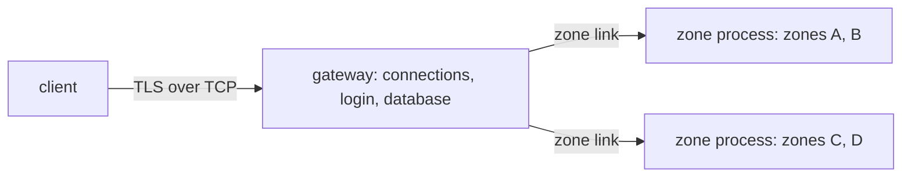
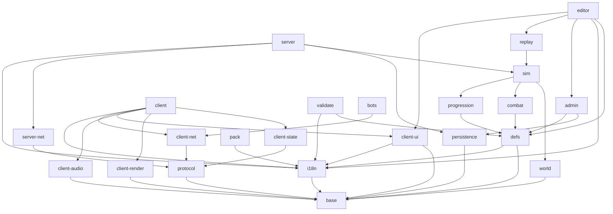

# Architecture

To change a crate you should only need its own code and the **public API** of the crates it depends on.

## Processes

One `server` binary runs as `all` (gateway and every zone in one process), `gateway` or `zone` ([runtime](runtime.md)).

## Crates

| Crate | Folder | Does |
|---|---|---|
| `base` | shared | ids, positions, directions, ticks, rarity |
| `i18n` | shared | languages, text packs, ICU-style formatting, plural and number rules |
| `defs` | shared | content types, loading RON files, validation |
| `protocol` | shared | client↔server messages and their encoding |
| `world` | shared | tile map, what blocks what, spatial grid, line of sight, paths |
| `combat` | shared | hit, damage, defense formulas |
| `progression` | shared | XP, gain by use, requirements, titles, classes |
| `sim` | server | the zone simulation (ECS with `hecs`): components, systems, events |
| `persistence` | server | accounts and characters in SQLite, versioned sheets, migrations |
| `server-net` | server | connections, TLS, frames, limits |
| `server` | server | the binary: modes, config, wiring |
| `client-state` | client | the client's copy of the world, interpolation |
| `client-render` | client | isometric projection, sprites, light and fog shaders (`wgpu`) |
| `client-audio` | client | mixer and per-platform audio backends |
| `client-ui` | client | theme, widgets, HUD, interface texts |
| `client-net` | client | the client's connection, on its own thread |
| `client` | client | the binary: frame loop, input, wiring |
| `validate`, `bots`, `pack`, `replay`, `admin`, `editor` | tools | see [tools](tools.md) |

## Allowed dependencies

Indirect dependencies are allowed. The checked source of truth is `arch.ron`: `validate arch` fails CI on any edge not listed there. A new crate goes into `arch.ron` and this page before it exists.

## Rules

1. **Downwards only.** No cycles.
2. **`shared/` is pure:** no IO, threads, network, rendering or clock; time arrives as a tick. Only `defs` reads files (content, sounds, asset names).
3. **`sim` is deterministic and does no IO.** It takes commands and returns events and views; it knows neither `protocol` nor `persistence`. Fixed point in rules, a seed per zone, replays.
4. **Binaries only compose.** `server` and `client` read config, do IO and translate between crates; game logic does not live there.
5. **Domains talk through events.** `combat` does not call `progression`; `sim` publishes `HitLanded` and the progression system listens.
6. **Small APIs.** Each crate re-exports its public items in `lib.rs`; the rest is `pub(crate)`.
7. **Content enters only through `defs`.**
8. **External dependencies need a reason** and may not require system tools or libraries to build.
9. **Types carry guarantees:** validated data has its own type (`ValidatedCatalog`, `BoundedString<N>`, `Locale`); items have no `Clone`.

## Where new code goes

- A formula with no world state → a domain crate in `shared/` (`combat`, `progression`, `world`).
- A rule over many entities → a system in `sim`.
- Network → `server-net` / `client-net`; disk → `persistence` / `defs`; screen → `client-render` / `client-ui`.
- Only wiring → the binary.
- A new kind of content → a type in `defs`, a form and validation in the editor, then data.

## Protocol in short

Messages (`ClientMsg`, `ServerMsg`) are encoded with `postcard`, framed with a `u32` length, over TLS (`rustls`) on TCP; swapping TCP for WebSocket or QUIC changes only that last layer. The client sends `Hello { version, locale }`, logs in, enters a character and gets definitions, a snapshot and then a diff every tick. Messages carry codes and text keys, never sentences; strings are bounded and numbers ranged at decoding. A client of another protocol version gets `IncompatibleVersion`.
