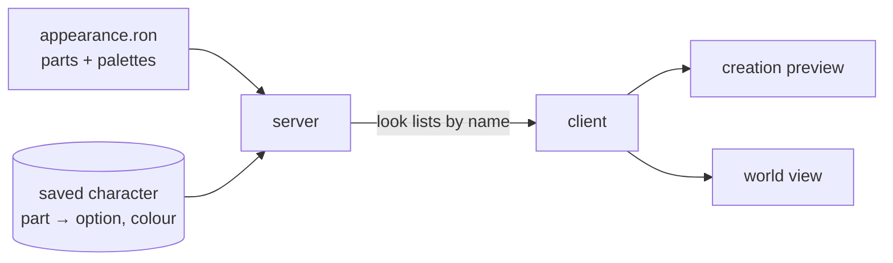

# Character parts (planned)

Today a character's look is four fixed lists: body, skin, hair style, hair colour ([appearance](content/characters.md#appearance)). Clothes come with the body and cannot be chosen. This page is the plan for a look the player builds from parts. Nothing here is in the engine yet; the [roadmap](roadmap.md) tracks it.

## 1. Parts as content

The game says in `content/appearance/appearance.ron` which parts a character has, in drawing order, and what each part offers:

```ron
parts: [
    (id: "body",  options: [(id: "body_a", sprite: "body_a")], palette: "skin"),
    (id: "hair",  options: [(id: "short", sprite: "hair_short"), (id: "bald")], palette: "hair"),
    (id: "top",   options: [(id: "tunic", sprite: "top_tunic")], palette: "cloth"),
    (id: "legs",  options: [(id: "trousers_boots", sprite: "legs_trousers_boots")], palette: "cloth"),
],
palettes: {
    "skin":  ["#f6d7c3", "#c99471", "#4f3224"],
    "hair":  ["#1b1b1f", "#d9b46a", "#a8371f"],
    "cloth": ["#3a8a4a", "#a8371f", "#2f5fb8"],
},
```

- A part's sprite is drawn tinted by the chosen colour (light grey art, as today); a part without a palette is drawn as it is.
- An option without a sprite draws nothing (bald, no top).
- Parts and options only grow, like every content id; a part may be marked as not offered at creation (e.g. given by a quest later).
- Each part gets its form and validation in the editor before it is ready.



## 2. The saved look

A character keeps, for each part, the option id and the colour index: `part id → (option id, colour)`. This replaces `base::Look` (four `u8`). It needs:

- a migration of saved characters: the four old fields become the parts `body`, `hair` and their colours; clothes start from each part's first option;
- a new protocol version: `Look` travels in entities, the character list and character creation;
- the world view, the creation preview and the character list keep drawing the same layers through one function, as now ([decisions](decisions.md) D28).

## 3. The "Character" screen in the editor

A screen of its own, not the generic form under *Advanced*:

- the preview built from the real layers, turning through the 4 directions and walking;
- beside it, each part with its options (sprite picker) and its palette (colour swatches);
- **Random** to try combinations; drag to reorder parts (drawing order).

## 4. Art

With parts apart, the tops, trousers and shoes already in `testes-arte/mvp/layers/` become choosable options. Art still goes to `testes-arte/` for review before any game's `assets/`.

## Open points

- ⚠ Open: which parts the template has (body, hair, top, legs, feet? beard, accessories?).
- ⚠ Open: colours free (a colour picker for the player) or only from the game's palettes.
- ⚠ Open: whether equipped armour hides the clothes parts under it, or is drawn over them.
