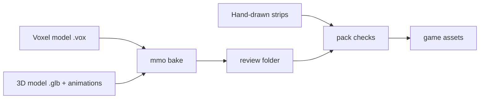

# Creator tools (ideas)

**Status: ideas only.** Nothing here is decided or scheduled; each idea becomes a roadmap item and a decision only when it is picked. The goal is one: **a person with no artist, no sound designer and no translator can still finish a game** with the kit.

Every idea keeps the kit's rules: content is data, art is called by name ([D8](decisions.md)), everything is reachable from the editor ([D7](decisions.md)), generated material goes to review before a game's `assets/`, and every file has a licence in `CREDITS.md` ([assets](assets.md)).

## Sprites

The biggest cost for a creator. Three ways in, all ending in the same 64×64, 4-direction strips ([D9](decisions.md)):

### Bake from voxel or 3D

- **`mmo bake`** renders a model with a fixed isometric camera into strips for each animation and direction: walk, attack, fall, idle (4 renders per animation, since there are 4 directions).
- **Pixel-art look by default**: render at low resolution, no smoothing, outline pass, light from a fixed angle, colours snapped to the game's palette, so baked art sits beside hand-drawn art.
- **Palette keys**: materials named in the model (`skin`, `hair`, `cloth_main`) become the palette keys the layered characters already use ([character parts](character-parts.md)); one base body with a skeleton serves every outfit.
- **Tiles and objects**: a voxel wall, tree or chest bakes into a tile or object with its footprint and light settings.
- **Editor**: upload a model, tick the animations, see it on a tile beside other art, send to review.
- **Retarget**: animations from one humanoid skeleton reused on others; a library of base animations shipped CC0 with the kit.

### Other sprite helpers

- **Recolour variants**: a wolf becomes a snow wolf by palette, no new art.
- **Icon from item**: bake or crop an inventory icon from the item's sprite.
- **Check on upload**: grid, frame count, palette and transparency checked with a plain message ("frame 3 is 66 pixels wide").
- **Starter packs**: CC0 packs (characters, monsters, tiles, icons) in the kit's format that the template can use.

## Sounds

- **Sound generator in the editor**: procedural effects from a few sliders and presets (hit, pickup, coin, magic, step, click), exported as Ogg; seeded so the same settings give the same file.
- **Import that fixes**: any common format is converted to Ogg 44 100 Hz, loudness normalised, silence trimmed, with a licence field required before save.
- **Variations**: make 3 to 8 slight variations of one sound (pitch, timing) for events that repeat ([assets](assets.md#sounds-and-music)).
- **Music**: a loop helper (find loop points, crossfade) and links to CC0 music in the starter packs.
- **AI sound and music** (optional, provider set by the creator): results land in review with the provider and licence recorded.

## Translation

The kit already treats every text as a key with all active languages ([D16](decisions.md), [translation](translation.md)). For a creator:

- **"Translate missing" button** per text, screen or the whole game, filling every active language with the AI agent and the game's glossary and tone rules.
- **Review view**: side by side per language, with length limits, placeholders and plurals checked live; a reviewer marks lines as checked.
- **Game glossary** in the editor: names that must never be translated or must always be translated the same way.
- **Stale marks**: when the English changes, other languages are flagged for review instead of silently kept.

## Everything else

| Idea | Saves the creator |
|---|---|
| **Wizards**: "new monster", "new shop", "new quest chain" ask a few questions and make valid content | reading the format pages |
| **Balance helpers**: XP and coin curves drawn from the formulas; "time to level 10" estimated; [economy](content/items-and-economy.md) flows per hour | spreadsheets |
| **Map helpers**: auto-tiling of edges and corners, brushes for forests and paths, random scatter of decoration | tile-by-tile painting |
| **Dialogue from a description**: AI drafts a dialogue graph from a paragraph, then the creator edits it (editor only, [D35](decisions.md)) | blank-page time |
| **Playtest bots**: run bots through a new zone and report stuck spots, unreachable items, quests nobody can finish | manual testing |
| **Templates by genre**: medieval, sci-fi, post-apocalyptic starting folders | a first look and feel |
| **Guides inside the editor**: short tips where a field is, linking to the doc page | searching the docs |

## When an idea is picked

It gets a roadmap row with "done when", a decision if it changes a rule, its editor screen and validation, and its tools page section ([tools](tools.md)).
