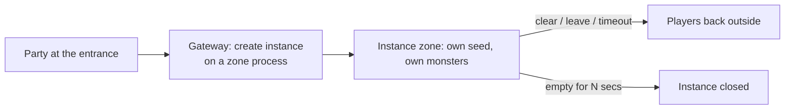

# Dungeons and raids (planned)

Closed places for a group (**dungeon**, up to 6) or many groups (**raid**, up to 40), with their own copy of the map so each party plays its own run.

## Instances

**In the engine** (steps G5 to G7): portals, the `Teleport` effect, zones marked `instance` that open a copy per party, close when empty, send everyone out on a time limit and save leavers at the exit ([D63](decisions.md)); `dungeons/` with level and group checks at the door, a boss that clears the run, lockouts, `clears` counters and fastest-clear rankings ([world](content/world.md#dungeons), [D64](decisions.md)). What follows is the rest of the plan: stages, phase scripts, raids, the finder.

Zones today are fixed partitions of one open world ([D12](decisions.md)). An **instance** is a new kind of zone:

- Built from a map in `zones/<id>/` marked `instance: true`, never joined by seams.
- Created on demand by a zone process the gateway picks (the least loaded); closed when empty for `close_after_secs`.
- Its own seed, so a run replays like any zone ([D13](decisions.md)); a crash restarts it from the entry.
- Entered by a portal tile or an NPC; left by an exit, by death (respawn outside) or by the timer.



## Content: `dungeons/<id>.ron`

```ron
(
    map: "crypt_of_ash",              // a zone with `instance: true`
    party: (min: 3, max: 6),          // raid: (min: 10, max: 40)
    level: (min: 20, max: 30),
    difficulty: [Normal, Hard],       // each with its own multipliers and loot
    lockout: Weekly,                  // None, Daily, Weekly — loot once per period
    time_limit_secs: Some(3600),
    stages: [
        Clear(region: "hall"),
        Boss(monster: "ash_warden", phases: "ash_warden_phases"),
        Event(event: "collapse"),        // [world event](world-quests.md) inside the instance
    ],
    rewards: [ (stage: 1, loot: "crypt_boss"), (on: Clear, title: Some("crypt_cleared")) ],
    records: true,                    // fastest clears on the server, with names
)
```

## Bosses with phases: `boss_phases/<id>.ron`

A first step is in the engine: `phases` on a monster ([world](content/world.md#boss-phases), [D62](decisions.md)). The blocks below come with instances.

Closed blocks only: `AtHealth(permille)` → `Summon`, `UseTechnique`, `AreaPattern(shape, delay)`, `Enrage(after_secs)`, `ChangeTiles(layer)`. Area patterns are drawn on the ground before they hit (the client shows the warning), so a raid is about reading and moving, which tile movement suits.

## Raids

- Same instance, larger party made of groups; loot rules: `Personal` (each rolls their own, no drama) by default, or `Master` by the raid leader.
- Raid bosses can need roles: content tags techniques as `Tank`, `Heal`, `Damage`; the entrance shows a warning when a role is missing, never blocks.
- Open-world **field bosses** stay in normal zones (see [mechanics](mechanics.md)); raids are the instanced version.

## Meaning

- **Server firsts** and fastest clears in the [chronicle](server-projects.md) and rankings.
- Raid materials feed masterwork recipes and [projects](server-projects.md) (a kingdom's army needs a dragon's scales).

## Editor

- Dungeon screen: stages, party, lockouts, rewards; **Test run** opens it alone with god mode.
- Boss phase editor: a timeline with health marks and the patterns drawn on the map.
- Validation: the map is an instance, the boss exists, every loot table exists, patterns fit the map.

## Engine work

1. `defs`: `instance` zones, `dungeons/`, `boss_phases/`.
2. Gateway: create and close instances, lockouts per character, party entry.
3. `sim`: stage progression, phase blocks beyond the first step, area patterns with warning ticks.
0. First, moving a player between zones without a seam (roadmap G5).
4. Client: instance timer, stage tracker, ground warnings, raid frames.

## How many instances (estimate, to be measured in W9)

From [performance](performance.md): a zone process costs ~15–30 MB empty, ~24 KB per player, and 2000 walking players take ~10 ms per tick (~5 µs each). Combat is not measured; we assume **5×** (~25 µs per active creature).

| Instance | Creatures awake | Tick cost | Memory (map shared read-only from content) |
|---|---|---|---|
| Dungeon (6 players, ~60 monsters, ~15 awake near the party) | ~20 | ~0.5 ms | ~1–2 MB |
| Raid (40 players, ~150 monsters, boss phases) | ~80 | ~2–4 ms | ~4–8 MB |

Demand: with 2000 players and ~25% in instances at peak, ~500 players → ~80 dungeons + ~2 raids.

**Decision (initial numbers, configuration, not code):**

- Cost in **units**: dungeon = 1, raid = 8.
- **20 units per instance thread** (~10 ms mean tick: 20 dungeons, or 2 raids + 4 dungeons), leaving the 41.7 ms worst case with room for spikes.
- **4 instance threads per zone process** by default → **80 units** per process; one process on the kit's reference machine covers the peak above.
- **World cap: 160 units** (two processes' worth); past it, parties wait in a queue with their position, like the login queue.
- Memory budget: **2 MB per dungeon, 8 MB per raid**; an instance over budget logs a warning and the editor flags its map.
- Monsters sleep when no player is near (lazy AI, already planned), which is what keeps a dungeon at ~20 awake creatures.

Change all of these in `server.ron` (`instances: (units_per_thread, threads, world_cap)`) after the W9 benchmark: `bots --behavior dungeon` with 80 parties.

## Finder

Many players play alone, so a **finder** forms parties for them.

- A player (or a partial group) queues for one or more dungeons and difficulties, with the roles it can play (from the tags on its techniques: `Tank`, `Heal`, `Damage`).
- The gateway fills parties by role and level range in queue order; when one is ready, each member gets a confirm with a timer; a decline or timeout puts the others back at the front.
- Players can come from any zone; on confirm they move straight to the instance and back to where they were after it.
- **Solo friendly**: dungeons may set `party.min: 1` and a `scaling` (monster health and damage by party size, content), and may offer **NPC companions** ([mercenaries](mounts-and-companions.md)) to fill empty roles.
- Raids are not in the finder by default (`finder: false` per dungeon), but a designer may allow it.
- Abuse: leaving a finder run early adds a short queue cooldown (content); vote-kick needs a majority and is logged.
- The finder counts against the instance budget; when the world cap is reached, it shows the queue position.

Editor: per dungeon, `finder: true/false`, role needs, scaling table, and a live view of queue lengths.

**One world only.** The finder never crosses worlds: a character and its items belong to one world's database ([D11](decisions.md), [D14](decisions.md)), and moving them for a run would break one owner per item and atomic saves. A quiet world is answered by solo scaling and NPC mercenaries above, and in operations by merging worlds ([D41](decisions.md)).
