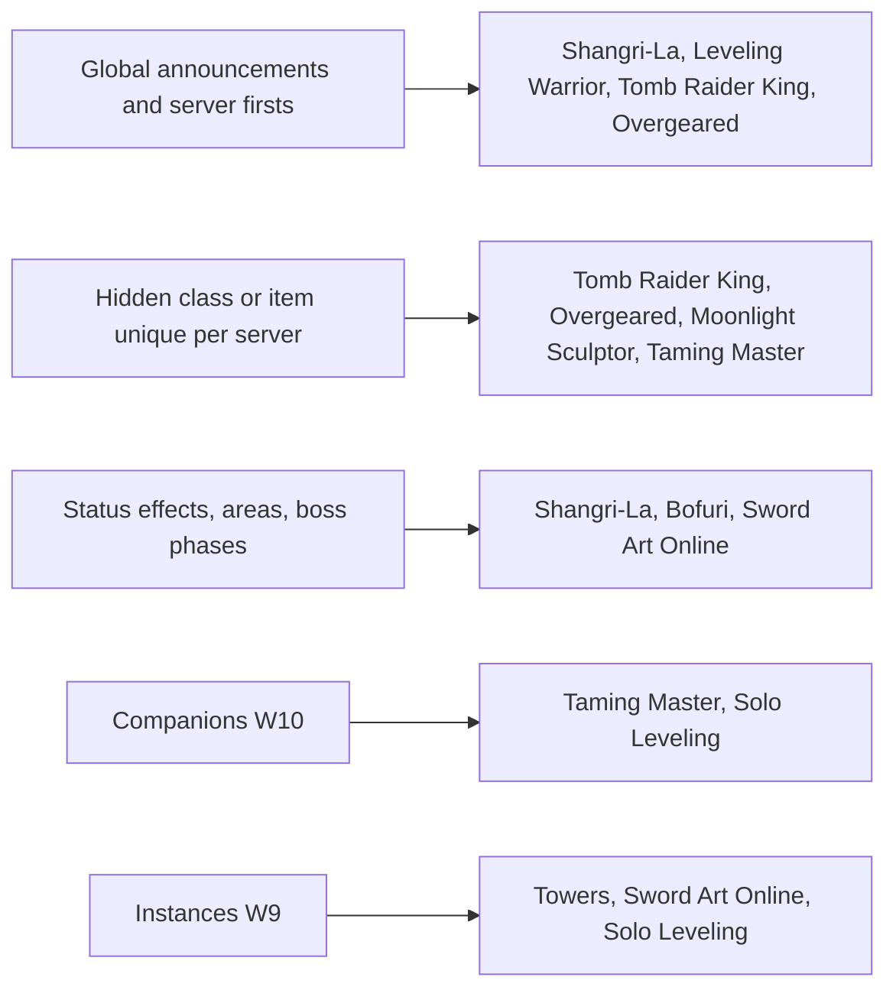

# Genre references

Stories about game worlds (Korean web novels and manhwa, Japanese light novels) that people ask the kit to make. For each one: what defines its game and what the engine still lacks. They are **references for mechanics only**: an example inspired by one has its own world, names and characters, and copies nothing (see [contributing](contributing.md)).

Distance: 🟢 close (mostly content), 🟡 one or two large mechanics, 🔴 far (several roadmap items), ⚫ does not fit.

## Close

| Work | What defines it | Missing |
|---|---|---|
| The Gamer | attributes and skills grow by use, titles, a "system window"; not an MMO, but works as one where every player is a gamer | almost nothing: proficiencies by use, techniques unlocked by proficiency and titles exist. Missing: the instant dungeon (a training zone stands in) and the system-window look (a theme) |
| Hardcore Leveling Warrior | ranked MMO, death costs a level, classes and titles | content only now (rankings and announcements exist) |
| Tomb Raider King | unique relics with powers, each with one owner | content only now (relics exist once) |
| Taming Master | a tamer, pets that grow and evolve | [companions](mounts-and-companions.md) (W10) |
| Bofuri | extreme builds the game rewards, skills earned by deeds | content only now (titles teach techniques; statuses exist) |
| The Player That Can't Level Up | growth by items and skill, not levels | content only now (dungeons exist) |

## Medium

| Work | Missing |
|---|---|
| Shangri-La Frontier | quests unique per server; bosses with phases and server firsts exist |
| Legendary Moonlight Sculptor | objects players place that buff an area, ranked quests, kingdoms |
| Sword Art Online | raid bosses, optional permanent death, houses |
| Second Life Ranker, Tower of God | floors as [instances](dungeons-and-raids.md) exist; trials per floor (stages) are next |
| Omniscient Reader | world events with goals for the whole server (W2, W4) |

## Far

| Work | Missing |
|---|---|
| Overgeared | recipes designed by players, [crafting with skill](crafting-minigames.md), guilds and kingdoms |
| Log Horizon | [living NPCs](living-npcs.md), [town politics](towns-and-politics.md), large raids |
| Ark | quests with several outcomes that change the world, territory |
| Solo Leveling | gates and dungeons, summons |

## What repeats

These five are the engine work that opens the most references at once. Announcements, unique titles, classes and items, statuses, boss phases and dungeon instances are done; companions (W10) come next ([roadmap](roadmap.md#genre-mechanics)).

## The first example

`examples/everyday-system/` is a small game in the style of The Gamer, made only of content: skills by use, titles for deeds, a unique title, an instant dungeon and rankings.
