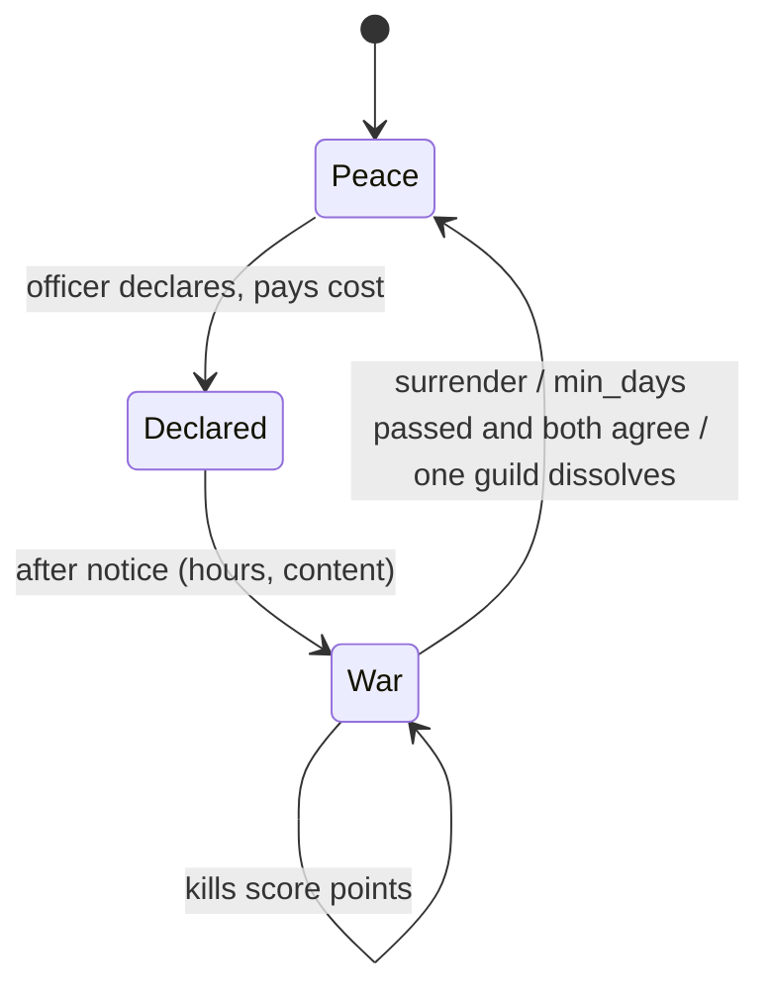

# Guilds (planned)

A guild is a player organisation with **members, ranks, a bank, a hall and a standing in the world**. It can fund [projects](server-projects.md) and [world quests](world-quests.md), hold a town in a [kingdom](kingdoms-and-nations.md), and fight other guilds.

## Data

Guilds are made by players, so they are **state in the gateway's database**, not content. What the designer edits is the **rules**: `guilds/rules.ron`.

```ron
(
    found_cost: 50000,                 // coins destroyed (a sink)
    found_level: 20,
    max_members: [ (level: 1, members: 30), (level: 5, members: 100) ],
    levels: [ (xp: 0), (xp: 10000), (xp: 40000) ],  // guild XP from members' deeds
    name_rules: (min: 3, max: 20),     // same filter as character names
    bank: (tabs_per_level: [1, 2, 3, 4], slots_per_tab: 40),
    tax: (max_permille: 100),          // share of members' quest coins the guild may take
    war: (declare_cost: 10000, min_days: 3, cooldown_days: 7, needs_accept: false),
    upkeep_per_day: [ (level: 3, coins: 500) ],   // a sink; unpaid → bank locked
)
```

## Members and ranks

- Ranks are named by the guild (checked by the filter); the leader sets **permissions per rank** from a closed list: `Invite`, `Kick`, `BankDeposit`, `BankWithdraw(per_day)`, `EditRanks`, `DeclareWar`, `ManageProjects`, `SpendTreasury(per_day)`, `Diplomacy`.
- Every guild action is logged (who, what, when) and visible to officers: a bank without a log invites theft drama the game cannot settle.
- Leaving: cooldown before joining another (content), so guilds cannot be hopped for war tricks.

## Bank

- Items keep identity and one owner ([D14](decisions.md)): the guild is the owner; withdrawals are atomic like trades.
- Coins in a guild treasury count in coin telemetry as a holder, not a sink.

## Hall

- A guild may rent or build a **hall**: a building in a town (an [instance](dungeons-and-raids.md) or a reserved region) with a crafting station, bank access and a trophy wall for [chronicle](server-projects.md) entries and server firsts.

## Guild war



- During a war, members of the two guilds may fight each other **outside `Safe` regions** even where normal PvP is off; the [karma](mechanics.md) penalty does not apply between them.
- Score: kills weighted by level gap, objectives (capture a banner in a region), and destroyed [siege](kingdoms-and-nations.md) works later.
- Outcome: points → coins from the loser's declared stake (escrowed at declaration), titles, chronicle entry. No item drops beyond normal death rules.

## Alliances

Two to five guilds may ally (shared chat, no war between them, shared war declarations). An alliance can found a [kingdom](kingdoms-and-nations.md).

## Editor

- **Guild rules** screen (the file above).
- **Guilds** live list for moderators: members, log, bank, wars; rename or disband for rule breaks, logged in `admin_log`.

## Engine work

1. Persistence: guilds, members, ranks, bank, log, wars.
2. Gateway: invitations, permissions, bank transactions, war state pushed to zones.
3. `sim`: PvP allowed between warring guilds; guild tag over names.
4. Client: guild window (members, ranks, bank, log, war), guild chat channel.

## Decided

- Decided ([D58](decisions.md)): names **unique per world**, compared after normalising case and look-alike letters.
- Decided ([D58](decisions.md)): wars **cannot be refused** by default (`needs_accept: false`), but guilds below a level or of new players set in the editor cannot be targeted.
