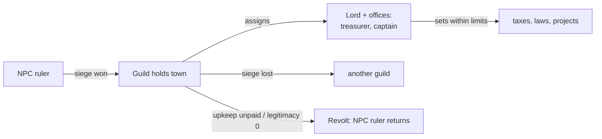

# Kingdoms and nations (planned)

The top layer: **territories that players hold**. It builds on [towns](towns-and-politics.md) (treasury, taxes, laws), [guilds](guilds.md) (who rules) and [projects](server-projects.md) (what is built), and gives wars a reason: land, taxes and a name in the chronicle.

## Levels of territory

| Level | Held by | Gives |
|---|---|---|
| **Town** | the designer's NPC rulers, or a guild that took it | taxes, laws, guards, a treasury |
| **Territory** (a set of regions around a town) | its town's holder | nodes and shops whose share goes to the treasury |
| **Kingdom** | a guild or alliance holding a capital town | titles of nobility, vassal towns, a royal treasury, foreign policy |
| **Nation** (optional) | the designer only | culture, starting region, language of NPC names: lore, not rule |

A designer decides in content which towns can **ever** be taken (`claimable: true`); starter towns stay NPC-ruled so new players are never under a hostile lord.

## Holding a town



- **Limits from content**: the lord changes a tax only within the town's `min..max`, turns on only the laws listed as allowed, and cannot touch starter-player protections.
- **Legitimacy** keeps working: a lord who overtaxes faces evasion and, at zero, a revolt event that returns the town to NPCs.
- Offices can be held by players or [NPCs with roles](living-npcs.md).

## Sieges

```ron
// sieges/rules.ron
(
    declare_cost: 100000,              // escrowed; lost by the loser
    notice_hours: 24,                  // defenders get time to gather
    window: (weekday: Sat, start_hour: 20, duration_min: 90),   // per town in its content
    objectives: [Gate("north_gate"), Hold(region: "keep", secs: 300)],
    works: [ (kind: Ram, recipe: "siege_ram"), (kind: Catapult, recipe: "catapult") ],
    defenders: (guards_from: Armoury, walls_from: Projects),
)
```

- **Siege works are crafted** (rams, catapults, ladders) and **walls are [projects](server-projects.md)**: crafters win wars as much as fighters.
- Guards fight with the **armoury's named items**; a broken sword in a defence keeps the record.
- Fixed windows per town so nobody loses a town at 4 a.m.; the time zone is the server's, shown in the client.
- Load: a siege window is a planned crowd; the zone uses the existing overload levels ([D10](decisions.md)), and a siege can be capped per side.

## Losing a siege

Every loss costs something, so a siege is never free to try or free to lose. All shares are content (`sieges/rules.ron`, `on_loss`).

| Side | Consequence (default) |
|---|---|
| **Defender loses** | the town passes to the attacker; **30% of the armoury is seized** (picked by value, masterworks first) and moves to the winner's armoury with its makers' names and the line "Seized at the siege of …"; **20% of the treasury** goes to the winner; built [projects](server-projects.md) go to a **damaged** map layer (walls broken) and a repair project opens; legitimacy −150; a chronicle entry |
| **Attacker loses** | the declared stake goes to the defender; its siege works are destroyed; a **cooldown** before it may besiege that town again; a chronicle entry |
| **Both** | equipment wear from the fight as usual; no extra item drops for players |

The seized share and treasury share are capped so one siege cannot empty a town; a town just taken is **protected** for some days (content) from another siege.

## Fines and standing (no bans)

A lord (or an NPC ruler) may **fine** a player. **Payment is never forced**: the game answers with the player's **standing in that town** (the [faction](towns-and-politics.md) standing and karma), not with a ban.

```ron
// towns/<id>.ron
fines: (
    max: 5000,                       // per fine
    reasons: ["theft", "brawl", "smuggling", "contempt"],   // text keys, chosen from a list
    expires_days: 30,                // an unpaid fine expires; the standing loss decays
    standing_per_unpaid: -200,
),
standing_bands: [
    (below: -200, effect: ShopPricePermille(1300)),
    (below: -400, effect: NoTrade),          // shops and the market in town refuse the player
    (below: -600, effect: GuardsHostile),    // the town's guards attack on sight inside its regions
    (below: -800, effect: NoServices),       // no repair, bank, teleport in this town
],
```

- Paying the fine at a town NPC restores the standing it took. Bribes, a pardon by the lord, or [world quests](world-quests.md) for the town raise it too.
- Effects apply **only in that town's regions**; the rest of the world is untouched.
- Abuse guard: fines per player per day are capped; every fine is logged with its reason and visible to the player; a player can appeal to the **king** (if the town is a vassal) or to the moderators in the editor, who can cancel a fine.

## Kingdom

- Founded by a guild or alliance holding a capital-flagged town, paying a cost; other held towns may **swear fealty** (vassals pay a share of taxes up).
- Ranks of nobility (content: `knight`, `baron`, `duke` …) the king grants within numbers set by content; each gives a title and a small office power.
- **Diplomacy** between kingdoms: `War`, `Truce(days)`, `Alliance`, `Tariff(permille)` on trade between their towns, `Embargo`.
- Kingdom history goes in the chronicle: founding, kings, wars, fallen towns.

## Editor

- Town form gains `claimable`, `capital`, limits for lords, siege window.
- **Sieges** rules screen; **Kingdoms** live list (holders, vassals, treaties) with moderator actions, logged.
- Validation: every claimable town has a keep region and a gate; siege works have recipes with a source.

## Order

1. Guilds → 2. claimable towns and sieges → 3. kingdoms and vassals → 4. diplomacy between kingdoms.

## Taxes by membership

Every tax rate in a held town is **configurable in the editor per group**, so the designer decides how hard a ruling guild may favour itself:

```ron
// towns/<id>.ron
tax_groups: [Holder, Allied, Citizen, Foreign],     // holder guild, its allies, citizens, everyone else
tax_limits: (
    shop_permille: (min: 0, max: 120),
    trade_permille: (min: 0, max: 60),
    max_gap_permille: 50,      // foreigners pay at most 5 points more than the holder
),
```

The lord sets each group's rate inside those limits; [legitimacy](towns-and-politics.md) falls when the gap is high, so favouritism has a cost.

## One town per guild

A guild may hold **one town** at a time; it cannot declare a siege on another town while it holds one. A kingdom grows through **vassals** (other guilds that hold their own town and swear fealty), never by one guild owning several towns. This keeps the world from being monopolised and gives more guilds a seat.

**Alliances and kingdoms are capped too** ([D43](decisions.md)): an alliance has at most 5 guilds ([guilds](guilds.md#alliances)), and no alliance or kingdom (with its vassals) may hold more than **25% of the claimable towns** (`max_share_permille: 250` in `sieges/rules.ron`, set in the editor). At the cap it cannot declare a siege or accept a new vassal.
