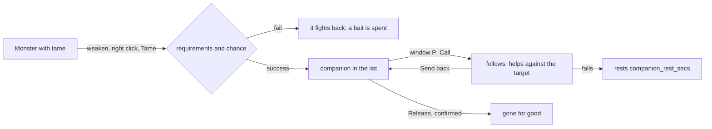

# Mounts and companions (companions partly built)

Two kinds of creatures that belong to a player: **mounts** carry them, **companions** fight or work beside them. Both are content; their behaviour is closed blocks.

## Built: tamed companions

The first step ([D69](decisions.md)), with every action in the interface:



- **Taming** is a block on the monster ([`tame`](content/world.md#taming)): requirements the designer picks (level, attribute, skill or profession, title, class, karma, a bait item), a share of HP to weaken it below and a chance. A monster without it cannot be tamed.
- **The companion** keeps the monster's stats and art, follows its owner, attacks the owner's target, takes threat (monsters may turn on it) and gives its share of XP and the loot to its owner. Players cannot attack it.
- **Window P** (a menu-bar button after the first tame): each companion with its state (following, ready, resting with a countdown) and **Call**, **Send back** and **Release** (asks once more). One follows at a time.
- **Limits** in `progression/formulas.ron`: `max_companions` (3) and `companion_rest_secs` (60).
- **Saved** with the character (sheet v11) by monster id; the one out travels with every seam, portal and instance.
- Counted as `tames` per monster, so titles, rankings and [server goals](content/characters.md#server-goals) can use it.

Not yet: growth (levels, XP share), loyalty, a name the player gives, behaviour toggles, workers and mercenaries, mounts.

## Mounts

```ron
// mounts/<id>.ron
(
    item: "warhorse_whistle",          // the item that summons it (has identity, can be traded)
    speed_permille: 1600,              // movement compared to walking
    summon_ticks: 40,                  // cast time; interrupted by damage
    forbidden_in: [Safe, Dungeon],     // region kinds where it cannot be used
    carry: Some(20),                   // extra bag slots while mounted
    stamina: Some((max: 600, regen: 2)), // gallop drains, walk regenerates
    combat: Dismount,                  // Dismount on hit, or Mounted(technique list)
    art: "mount_warhorse",
)
```

- One creature per tile still holds ([D4](decisions.md)): a mounted player is one entity.
- Speed is a tick rate, not free movement, so the server still decides every step.
- Mounts from breeding or taming come later; first from shops, quests, [projects](server-projects.md) and crafting (a saddle maker class).

## Companions

```ron
// companions/<id>.ron
(
    kind: Pet,                         // Pet (fights), Mercenary (hired NPC), Worker (gathers / hauls)
    monster: "wolf_tamed",             // stats and art from a monster
    behaviour: [Follow, Assist, Guard(radius: 3)],   // closed list the player toggles
    growth: Some((xp_share_permille: 200, max_level: 30)),
    loyalty: Some((start: 500, lost_on_death: 100, gained_per_hour: 5)),
    upkeep: Some(Coins(per_hour: 10)),  // mercenaries cost; a sink
    limit: 1,                           // at once
)
```

- **Taming**: built as a block on the monster (above), not a technique.
- **Companions count as threat sources** and share XP; a companion takes a share, so it is not free power.
- **Workers** gather from nodes for their owner at a slower rate, never while the owner is offline, and count in bot telemetry like a player's own gathering.
- **Mercenaries** are NPCs: they can have [memory](living-npcs.md) and loyalty, and may leave if unpaid.

## Meaning

- A companion has a **name the player gives** (checked by the same filter as character names), a level, and a history (kills, dungeons cleared) shown on inspect.
- Legendary companions or mounts can be **unique per server** like legendary classes.

## Editor

- Mount and Companion screens, with the monster and item as pick lists and a preview of speed per tick.
- Validation: the summoning item exists and has a source; region kinds exist; `limit ≥ 1`.

## Engine work

1. `defs`: `mounts/`, `companions/`, taming technique effect.
2. `sim`: mounted movement rate, companion entities owned by a player (AI from monster AI plus behaviour flags), handed over across seams with their owner.
3. Persistence: companions saved with the character (level, loyalty, name, history).
4. Client: mount and companion art, a companion bar with behaviour toggles.

## Decided

- Decided ([D59](decisions.md)): first version **`Dismount` only**; `Mounted` is appended later.
- Decided ([D59](decisions.md)): companions **travel with the owner's hand-over**.
