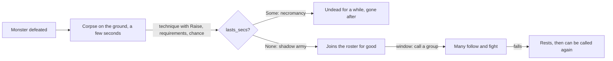

# Raising the dead (planned)

Companions from the fallen: a player raises a defeated monster to fight for them. It builds on [taming and companions](mounts-and-companions.md) (a creature that follows, fights, takes threat and gives its owner XP and loot) and changes three things: **where it comes from** (a corpse), **how long it stays** and **how many** stand at once. One content block covers two styles, chosen by data:

| Style | Lasts | How many | Feels like |
|---|---|---|---|
| **Necromancy** | a while (`lasts_secs`), never saved | several, short lived | a necromancer of classic fantasy |
| **Shadow army** | for good, saved with the character | many, kept in a roster, called in groups | the summoner who builds an army from every boss (genre reference: Solo Leveling) |



## Content (all in the editor)

On the monster, a block next to `tame`:

```ron
raise: Some((
    requires: [Class("necromancer"), Proficiency("dark_arts", 10)],  // the same open list as tame
    becomes: "skeleton_wolf",   // another monster: its own art and stats
    chance_permille: 1000,      // a shadow army may make strong ones hard: 50 for a boss
    tries: 3,                   // attempts on one corpse before it crumbles (0: unlimited)
    lasts_secs: Some(120),      // None: kept for good (shadow army)
)),
```

- `becomes` is an ordinary monster, so the risen keeps the designer's art and balance in one place; a game may point it back at the same monster.
- A technique gets the effect `Raise`, with its MP, cooldown, reach and level like any other; its level can add to how many stand at once.
- `progression/formulas.ron`: `corpse_secs` (how long a corpse stays), `max_risen` (temporary ones at once), `max_army` (kept ones) and `army_out` (kept ones out at once). A special attribute or a title bonus may raise the last two, so a game can tie the army to a stat.
- Counted as `raises` per monster, for titles, rankings and [server goals](content/characters.md#server-goals).

## Engine work

1. **Corpses**: a defeated monster with `raise` leaves a corpse entity for `corpse_secs`: no AI, only a target for `Raise`. Art: the monster's `corpse` sprite, else a generic one.
2. **Many companions at once**: today one follows each owner. The AI already runs each companion apart; the owner keeps a list of the ones out, up to the limits.
3. **Temporary companions**: an end tick; never saved; they crumble when the owner leaves the game.
4. **The army**: kept ones are saved like tamed companions (monster id, name, rest), with their own limit, and called **in groups**.
5. **Interface**: window P gets a tab per kind (Tamed, Army); the army tab calls or sends back everyone, or a group the player made (a few named groups), and shows how many are out. Corpses show a small mark when the player can raise them, and the monster menu (right click) offers **Raise** next to Tame.
6. **Commands for the group** (later): all attack my target, all guard me, all come back.

## Balance

- Every risen counts as a threat source and takes its share of XP, as companions do: an army is not free power.
- `army_out` keeps a crowd from flooding a zone; the [overload levels](runtime.md) still thin far AI.
- Corpses belong to the party that made the kill, so raising never turns into a race between strangers.

## Decided

- Decided ([D74](decisions.md)): one `raise` block serves both styles; `lasts_secs` chooses temporary or kept.
- Decided ([D74](decisions.md)): only monsters with `raise` can be raised; never a player.
- Decided ([D74](decisions.md)): the risen is another monster (`becomes`), not a tinted copy.

## Open

- ⚠ Open: may an army companion grow (levels, a rank) like the tamed ones will ([companions](mounts-and-companions.md))?
- ⚠ Open: group commands beyond follow and assist (guard a spot, hold back) in the first version or later.
