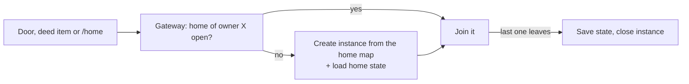

# Player homes (planned)

A **home** is a private place a character owns: a plot with a house, fields, pens and workshops. It is an [instance](dungeons-and-raids.md#instances) of a map, so a thousand homes take no space in the open world and cost nothing while empty.

Homes give a reason to come back (crops ripen, animals breed, the house grows) and a place to meet (visits, a stall, shared work). Three skills live mostly here: **farming**, **breeding** and **carpentry**.

## A home is an instance that remembers

Dungeon instances start fresh every run. A home starts from its map and then applies its **saved state**: placed objects, plots, pens, storage.



- One instance per home, keyed by the owner; visitors join the same one.
- Built on roadmap G5 (moving without a seam) and G6 (zones made at runtime); a home is an instance kind `Home` that never times out while someone is inside.
- State is saved like a character: on change batches and on close, atomically with any item moved in or out ([D14](decisions.md)).
- Budget: a home counts **¼ unit** ([D34](decisions.md)); few creatures, nothing awake most of the time.

## Content: `homes/<id>.ron`

```ron
(
    map: "cottage_plot",                 // a zone marked `instance: Home`
    entrance: "riverside_door",          // a door tile in the world, or None for /home only
    source: [Shop("estate_agent"), Quest("first_roof"), Project("new_village")],
    size: (fields: 6, pens: 2, furniture: 40, storage: 60),
    upgrades: [ (to: "farmhouse_plot", cost: [Coins(50000), Item("oak_beam", 40)]) ],
    visitors: 12,                        // at once
)
```

- A home is granted by a **deed**: an item with identity. Selling a home is selling its deed; the state moves with it, minus storage, which goes to the old owner's mail.
- Upgrades swap the map for a bigger one; placed objects keep their tile when it still exists, the rest go to storage.

## Farming

- **Plots** are tiles that accept seeds. A crop has stages with a duration in **world days**, a yield table and needs (`Water`, `Fertilizer`) that raise quality, never block growth.
- Growth is **computed on load** from the world day the gateway passes to the instance, not by a timer: an empty home costs nothing and the result is deterministic.
- **Crops never die** of neglect. Missing a day loses a bonus, not the harvest: players come back for the reward, not out of fear.
- A proficiency (`Farming`) grows by use like any other; seeds, fertilizer and recipes are content.

## Breeding

Needs [companions](mounts-and-companions.md) (W10).

- **Pens** hold companions or farm animals (a `Livestock` kind that only produces: eggs, wool, milk).
- Two compatible creatures in a pen may give an **egg** after content's `breed_days`. The child's traits come from both parents with a seeded roll: stats within a range, a chance of a rare variant, a line of ancestors shown on inspect.
- A child is an item with identity until hatched, so it can be traded, sold at a stall or gifted.
- Rare variants can be **firsts on the server** ([D61](decisions.md)).

## Carpentry

- Furniture is an item with a `Furniture` part: footprint, art, and an optional **function**:
  - `Storage(slots)`, `Bed` (resting bonus on next login), `Station(recipe tag)` (craft here), `Display` (shows an item or a title), `Light`.
- Crafted furniture is **signed by its maker** like any crafted piece, so good carpenters are known.
- Placing is a home mode: pick from storage, rotate (fixed directions), place on free tiles; validated by the server.

## Coming back

| Hook | How |
|---|---|
| Crops and eggs ready | a short line at login: "3 fields ready, 1 egg" |
| Rested | sleeping in a bed gives a small XP bonus for the first hour back |
| A house that grows | upgrades, rare furniture from dungeons and [projects](server-projects.md) |
| Trophies | `Display` furniture shows titles, server firsts, records, a relic |
| Seasons | seeds that grow only in some world seasons, set in content |

Nothing here punishes absence; every hook is a reward for returning.

## Social

| Mechanic | Depth it adds |
|---|---|
| **Visit rights**: private, friends, group, guild, public | homes become meeting places |
| **Co-owners** (up to 3, e.g. marriage) with a shared chest | play together without trading |
| **Helping**: a visitor may water or feed; both get a small reward, once per home per day | daily reasons to visit each other |
| **Stall**: a `Display` sells items to visitors through escrow, with a tax to the home town ([towns](towns-and-politics.md)) | a player economy before the global market |
| **Workshop for hire**: a `Station` others may use for a fee the owner sets | good stations are worth travelling to |
| **Guestbook** and **likes**; a weekly "homes of the server" [ranking](decisions.md) | showing off is free content |
| **Housewarming**: the first visit of N players unlocks a title | gathering is rewarded |
| **Guild hall** = a home owned by a guild ([guilds](guilds.md)) | one system, two uses |

## Editor

- Home screen: map, size, sources, upgrades; **Test** opens it empty as owner.
- Crop, livestock, breeding and furniture forms; a growth timeline preview in world days.
- Validation: the map is a `Home` instance, every furniture footprint fits, every seed and egg has a source, upgrades point to existing homes.

## Engine work

1. G5 and G6 (instances), then `instance: Home` with saved state.
2. `defs`: `homes/`, crops, livestock, breeding, the `Furniture` item part.
3. `sim`: plots and growth from the world day, pens, placement, home permissions.
4. Gateway: open/join by owner, deed ownership, visit rights, the helper limit.
5. Persistence: home state tables, saved with item moves.
6. Client: placement mode, plot and pen views, login summary.

## Decided

- Decided ([D63](decisions.md)): homes are persistent instances keyed by owner; crops grow from the world day computed on load; neglect never destroys.

## Decided

- Decided ([D70](decisions.md)): **one home per character**.
- Decided ([D70](decisions.md)): **no visits while the owner is offline**; visitors enter only with the owner in the game, and leave when the owner does.
