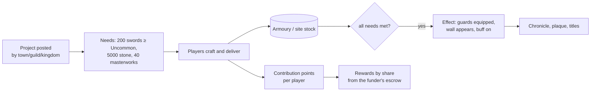

# Server projects (planned)

Collective works for a town, a guild or a kingdom: **forge for an army, build a wall, raise a bridge, equip a fleet**. Players deliver what they make; the items **do not vanish**: they live on in the world with their makers' names, and the work leaves a mark everyone can see.

## What gives it meaning

| Mark | What players see |
|---|---|
| **Items stay items** | A sword delivered to the army is not destroyed: it moves to the project's **armoury** and is **equipped by the NPC guards and soldiers**. Inspect a guard: "Iron sword, made by *Ana*, masterwork 973". When the town is attacked, those swords fight |
| **The building changes** | A finished wall, bridge or forge **appears on the map** (a tile layer that switches on) with a plaque listing the top contributors |
| **The chronicle** | Every finished project is written in the town's **chronicle**: date, what was built, contributors by share. Readable at a lectern NPC and in the client |
| **Titles and records** | Titles for contributing (`Builder of the North Wall`), and "first on the server" records |
| **Wear and history** | Equipment in an armoury wears in battle; a sword that survived three sieges shows it ("Fought in 3 defences") |
| **Reclaim** | A maker can buy back their own retired piece from the armoury when it is replaced |

Because items have identity and one owner ([D14](decisions.md)), the armoury is just another owner: the town, guild or kingdom. Nothing is duplicated.

## The loop



## Content: `projects/<id>.ron`

```ron
(
    owner: Town("aurelia"),             // Town, Guild or Kingdom
    needs: [
        Items(kind: Tag("sword"), qty: 200, min_rarity: Uncommon),
        Items(item: "cut_stone", qty: 5000),
        Masterworks(kind: Tag("armor"), qty: 40),
        Coins(20000),
    ],
    deadline_secs: Some(604800),
    effect: [
        EquipGuards(town: "aurelia", slot: MainHand),   // from the armoury
        MapLayer(zone: "aurelia", layer: "north_wall"),
        TownChange(town: "aurelia", stat: Defense, delta: 200),
    ],
    rewards: (
        pool: Coins(15000),            // escrowed from the owner's treasury
        by: ContributionShare,
        titles: [(min_share_permille: 10, title: "builder_north_wall")],
    ),
    start: Manual,                     // or When(Condition) — e.g. a war declared
)
```

- **Contribution points** weigh value and quality: a masterwork counts more than a common piece. The weights are content.
- `start: When(...)` links to [signals](world-quests.md) and [kingdoms](kingdoms-and-nations.md): a declared war opens "Forge for the army".
- Delivery is at a project NPC or site; partial deliveries count at once.

## Editor

| Screen | What the designer does |
|---|---|
| **Projects** | needs, effects, rewards, start; live progress bar and top contributors |
| **Armouries** | what each owner holds, who made it, condition; retire or return pieces |
| **Chronicle** | read and hide entries (moderation); entries are written by the engine only |
| **Map layers** | the tiles a project turns on, painted in the map editor as a hidden layer |

## Engine work

1. `defs`: `projects/`, `Tag` on items for "any sword", `MapLayer` in maps.
2. Gateway: project state, contributions, escrow, armoury as an owner in the database, chronicle table.
3. `sim`: NPC guards draw equipment from their owner's armoury; map layers on/off; wear in battle.
4. Client: project window, inspect shows maker and history, chronicle reader, plaques.

## Lending armoury gear in a defence

Defenders may borrow armoury pieces **only during a siege defence**, and nothing about it can be stretched or kept.

- **Ownership never moves.** The item stays owned by the armoury; the character gets a **loan**: a reference that lets it equip that piece. There is no moment in which the player owns it, so trade, mail, bank, market, drop, sell, dismantle, enhance, repair, crafting and quest delivery all refuse it ([D14](decisions.md)).
- **Only inside the siege.** A loan exists only in the town's siege regions while the siege window is open. Leaving those regions, logging out, falling, dying or the window closing **returns it at once** (unequipped, back in the armoury).
- **Players cannot start or stretch a defence.** A defence exists only in the town's fixed siege window, opened by a declared siege; its end time is fixed when it is declared and nothing extends it.
- **The gateway is the source of truth.** Loans are rows with the siege id; when a siege ends, the gateway returns every loan in one transaction. On a crash or restart, any loan whose siege is over is returned before players load.
- **Wear counts for the armoury**: damage taken in the defence lowers the piece's durability and adds to its history ("Fought in 3 defences").
- Who may borrow: a rank permission (`ArmouryBorrow`) for guilds, or the town's citizens with standing above a band; a cap of pieces per player.
- Telemetry: loans per siege and any refused action on a loaned item are logged; repeated attempts show up for moderators.

## Open


A lost siege has consequences for the armoury: see [kingdoms](kingdoms-and-nations.md#losing-a-siege). Seized items keep their maker and gain the line "Seized at the siege of …".
