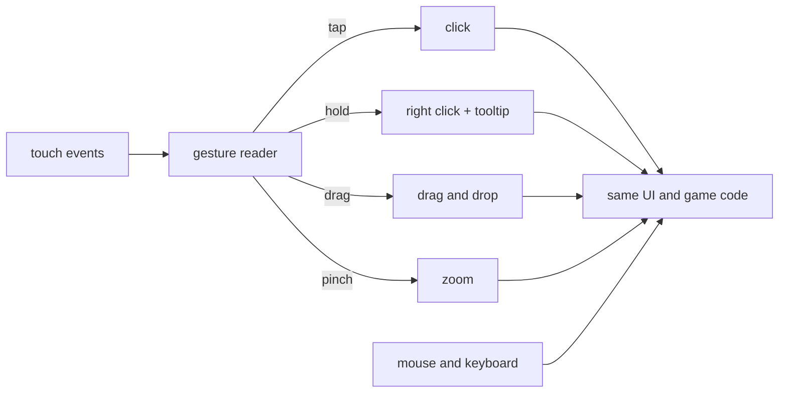

# Touch and phones

Planned: what the client needs so a game made with the kit is playable on a phone, in the [browser client](web.md). Today the client reads only mouse and keyboard; the interface already scales with the screen's density (logical pixels times the device scale), so sizes are a small part of the work and input is most of it.

The rule: touch is **translated into the input the client already has**, so every screen, window and game action works on both without a second code path.

## What is missing today

| Area | Today | On a phone |
|---|---|---|
| Input | mouse buttons, wheel, keys; no touch events | nothing beyond a tap read as a click |
| Right click | world actions, sell and mend at a shop | no right button |
| Hover | tooltips of items and techniques | no hover |
| Keys | Enter, Esc, Tab, chat typing | no keyboard until a text field asks for one |
| Zoom | mouse wheel | pinch |
| Sizes | buttons and list rows about 32 pt, small text 13 | targets need 44 to 48 pt |
| Layout | several windows open side by side | one screen holds one window |

## 1. Gestures

The client turns touch into its existing input, before the UI runs:

| Gesture | Becomes |
|---|---|
| Tap | left click at the point |
| Hold (about 450 ms, finger still) | right click; on a slot, its tooltip until the finger lifts |
| Drag from a slot | the same drag as the mouse (hotbar, backpack, trade) |
| Drag on the world | nothing first; walking stays tap to move |
| Pinch with two fingers | the zoom the wheel gives |
| Two-finger tap | Esc (close the top window) |

A finger that moves more than a few pixels is a drag, never a tap or a hold. Only the first finger points; a second one only pinches.

## 2. Touch mode and sizes

The client is in **touch mode** when the last input was a touch, and back in mouse mode on the next mouse move. Touch mode:

- uses the theme's `touch_sizes` instead of `sizes` (both content, in `themes/<id>.ron`), with defaults for touch: hotbar slot 56, button and list row at least 48, text 18, small text 15;
- never shows hover effects;
- shows the on-screen buttons below.

Players can also set an **interface scale** (80 % to 150 %) in the options, kept by the client like the volume.

## 3. On-screen buttons

Keys a phone lacks become buttons, shown only in touch mode:

- **Menu** (the existing menu slot): backpack, character, techniques, quests, options.
- **Chat**: opens the chat line; the browser's keyboard comes up for the text field and the field moves above it.
- **Close** on every window, at least 48 pt (Esc for touch).
- **Target next** (Tab) and **Talk** (F, the nearest NPC).
- Hold on a creature replaces right click: shop, player menu (whisper, trade, invite, revive).

## 4. Layout for small screens

Below a width of about 700 logical pixels (a phone held either way):

- one window at a time, filling the screen above the hotbar; opening another replaces it;
- the minimap shrinks to a corner button that opens it full screen;
- the chat log shows its last 3 lines and grows when tapped;
- shop, trade and backpack become one screen with tabs instead of two windows side by side.

Wider screens (tablets) keep today's layout with touch sizes.

## 5. Browser details

- The page stops the browser's own gestures on the canvas (scroll, double-tap zoom, long-press menu) with `touch-action: none` and no context menu.
- Full screen and landscape lock are offered by a button, since browsers only allow them after a tap.
- Text fields use a hidden HTML input so the phone's keyboard, autocorrect and other alphabets work.

## Order of work

| Step | Done when |
|---|---|
| T1 | Touch events become tap, hold, drag and pinch in the native and browser clients | every action works with a finger on a tablet |
| T2 | Touch mode with `touch_sizes` in the theme, its editor form and the interface scale option | buttons and slots are comfortable to hit |
| T3 | On-screen buttons and the keyboard for chat in the browser | nothing needs a physical keyboard |
| T4 | Small-screen layout | the template is playable on a phone held sideways |

## Open

- ⚠ Open: walking by holding a direction (a virtual stick) besides tap to move; tap to move is enough for the isometric click-to-walk games the kit makes.
- ⚠ Open: portrait as well as landscape, or landscape only.
