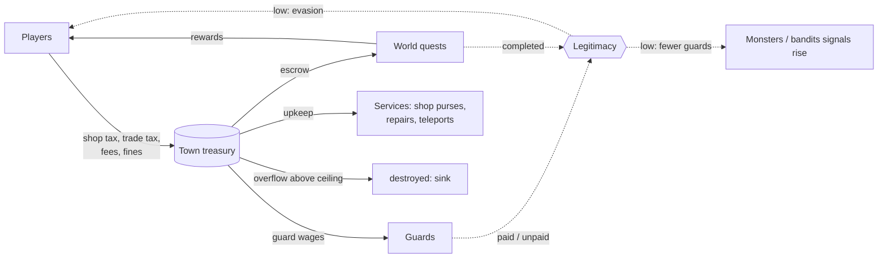

# Towns, treasury and politics (planned)

A **town** holds a treasury, collects taxes, pays guards and services, funds [world quests](world-quests.md) and has a **legitimacy** that players change by what they do. Every number is content edited in the editor; nothing is fixed in code.

Goal for the economy: today coins leave the world as sinks (shop gap, repairs). With towns, part of that money **circulates** (taxes → treasury → wages and quest rewards → players) and the designer sees and steers the flow.

## The economic loop



The **legitimacy spiral** from Questless is the core dynamic: an empty treasury cannot pay guards → legitimacy falls → players and NPCs evade taxes (less collected) → fewer guards → danger signals rise → world quests ask players to restore order. Players can break the spiral (tribute, reinforcement, donations) or profit from it.

## Content: `towns/<id>.ron`

```ron
(
    regions: ["aurelia_center", "aurelia_market"],   // where its laws and taxes apply
    treasury: 5000,                  // starting coins (copper)
    ceiling: 200000,                 // above it, the overflow is destroyed (a sink)
    taxes: (
        shop_permille: 50,           // of each NPC shop purchase in its regions
        trade_permille: 20,          // of coins in player trades in its regions
        teleport_fee: 30,
    ),
    guards: (npc: "town_guard", wanted: 8, wage: 40, pay_every_secs: 3600),
    legitimacy: (
        start: 700,                  // 0..1000
        unpaid_guard: -15,           // per guard per missed pay
        quest_completed: 2,          // per world quest the town funded
        tax_over_permille: (60, -1), // each window a tax is above 6%: -1
        recover_per_window: 1,       // towards `start` when nothing happens
        window_secs: 600,
    ),
    evasion: [ (below: 400, permille: 300), (below: 200, permille: 700) ],  // taxes not collected
    effects_below: [ (legitimacy: 300, guards_permille: 500), (legitimacy: 150, safe_region: false) ],
    laws: ["no_pvp_center"],
    leader: Npc("mayor"),            // or Council (phase P3)
)
```

### `laws/<id>.ron`: rules a town turns on

A law is a closed block, not a script: `ForbidPvp(region)`, `TaxRate(kind, permille)`, `Curfew(region, night)`, `BanItem(item)` (shops in town refuse it), `BountyOnMarked(coins)`. A town lists its active laws; changing the list is a **policy change**, logged and shown to players.

### `factions/<id>.ron`

Groups with a standing per town and per player (`-1000..1000`): guilds, merchants, bandits. Standing opens dialogues and quests (`Condition::FactionStanding`), changes shop prices (`price_permille` by standing band) and decides who funds what.

## Politics, in phases

| Phase | Who decides | What exists |
|---|---|---|
| **P1 Steward** | the designer in the editor | towns, treasury, taxes, guards, legitimacy, laws; changes are live and logged |
| **P2 Rules of the town** | content rules | `leader` NPC applies a **policy table**: e.g. treasury below X → raise `shop_permille` by Y, legitimacy below Z → post "Reinforce the guard". The designer edits the table, not code |
| **P3 Players** | players with standing | a council: proposals from a closed list (change a tax within limits, turn a law on/off, fund a project), votes weighted by standing or citizenship, a term length; the designer sets limits players cannot pass |
| **P4 Between towns** | towns and factions | tariffs between towns, alliances, embargoes, contested regions |

P3 rule: **players never get a power the designer did not allow**: every proposal kind has min/max in content.

## Editor

| Screen | What the designer does |
|---|---|
| **Town** | edit all fields above; live panel: treasury, income/expenses per source today, legitimacy chart, guards paid/unpaid, evasion |
| **Laws** | create laws from blocks; turn on/off per town (live, with a confirm and a log line) |
| **Factions** | standings; price bands; who is hostile to whom |
| **Policy table** (P2) | rows "when → do", each with a preview "would fire now?" |
| **Economy** (existing) | the town's flows join coin telemetry: taxes collected, wages, escrow, overflow destroyed |

Validation: rates in 0..1000, a town's regions exist and do not overlap another town's, the guard NPC exists, `ceiling ≥ treasury`, every law and faction referenced exists, a policy row cannot set a value outside its declared min/max.

## Engine work

1. `defs`: `towns/`, `laws/`, `factions/` with editor schemas and validation.
2. Gateway (only writer of the database): **town accounts** in the database, atomic with player coins (same rule as trades, [D14](decisions.md)); applies taxes reported by zones; pays wages; holds quest escrow; persists legitimacy and standings.
3. `sim`: tax on shop purchases and trades in a town's regions (the share goes to the town instead of being destroyed); law effects (PvP, curfew, banned items); guard count from the town.
4. Telemetry: every town flow is a named coin source or sink, so `admin report economy` still balances.
5. Protocol and client: a town panel (taxes, laws, legitimacy shown as a word, not a number), notices when a law changes.

## Order of delivery

1. Town + treasury + taxes + telemetry (no politics yet) — the money starts to circulate.
2. Signals + world quests funded by the town — the [world quests](world-quests.md) examples.
3. Guards and legitimacy + evasion — the spiral.
4. Laws and factions.
5. Policy table (P2), then council (P3), then between towns (P4).

## Decided

- Decided ([D56](decisions.md)): the tax **replaces part of the shop sink**: prices do not change; the overflow above the ceiling is still destroyed.
- Decided ([D56](decisions.md)): **one home town per character**; changing it costs a fee (a sink) and has a cooldown; citizens get their tax group, armoury loans and a vote.
- Decided ([D56](decisions.md)): zones report taxes per (zone, window number); the gateway applies each report **once**.
- Decided ([D56](decisions.md)): **one vote per account per town**, from a citizen character above a playtime and standing set in the editor.
