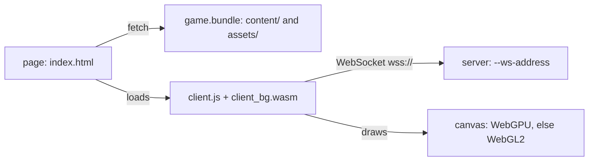

# Browser client

The same client code also builds for the browser (`wasm32-unknown-unknown`). A player opens a link and plays; nothing to install. Decision: [D29](decisions.md).



## Play locally (one command)

```sh
./client/client/web/play.sh                      # templates/new-game
./client/client/web/play.sh examples/riftara     # the example game
```

It installs what is missing (the wasm target and `wasm-bindgen-cli`, the version from `Cargo.lock`), builds, starts a dev server and serves the page. It prints the link to open; Ctrl+C stops both. Files go to `dist/` (ignored by git).

## Setup

What each tool is, and where it comes from:

| Need | Where it is declared | Installed by |
|---|---|---|
| `wasm-bindgen` (library) | `Cargo.toml` (workspace), locked in `Cargo.lock` | `cargo` |
| `wasm32-unknown-unknown` (Rust target) | `rust-toolchain.toml` (`targets`) | `rustup`, on the first `cargo` run |
| `wasm-bindgen-cli` (generates the JS glue) | the version in `Cargo.lock` | `cargo install wasm-bindgen-cli --version <that version>` (not a crate dependency, so the lock cannot install it) |

`play.sh` installs the CLI if it is missing and checks the target. Installing the CLI by hand is the only manual step:

```sh
cargo install wasm-bindgen-cli --version "$(grep -A1 '^name = "wasm-bindgen"$' Cargo.lock | sed -n 's/^version = "\(.*\)"/\1/p')"
```

## Build

```sh
./client/client/web/build.sh templates/new-game out/web
```

`out/web` then holds `index.html`, `client.js`, `client_bg.wasm` and `game.bundle`. Serve it as static files from any web server (HTTPS in production); the browser needs `.wasm` served as `application/wasm`.

`game.bundle` is the game's `content/` and `assets/` in one file, written by `web-bundle CONTENT ASSETS OUT` (crate `client-files`). Rebuild it whenever the game's files change; the `.wasm` only changes with the kit.

## Server

Browsers cannot open raw TCP, so the server listens for them on a second port:

```sh
server --address 0.0.0.0:7000 --ws-address 0.0.0.0:7001 --ws-origin https://play.example.com
```

- The WebSocket uses the **same TLS** as the game port (`wss://`). The browser must trust the certificate: use a real one (such as Let's Encrypt) for the server's name; the self-signed one and `--trust-cert` only serve desktop clients.
- `--ws-origin` (repeatable) lists the pages allowed to connect; others get `403`. Without it, any page may connect, which is fine for development only.
- Each binary WebSocket message carries bytes of the same length-prefixed frame stream as TCP, so limits, rate limits and messages are the same code ([security](security.md)).
- `--dev` serves plain `ws://` on localhost, like its plain TCP.

## Page parameters

The query string replaces the command line: `?server=play.example.com:7001&locale=pt-BR` reads as `--server play.example.com:7001 --locale pt-BR`. A full `wss://…` URL works as the server too. For development:

```text
http://127.0.0.1:8080/?server=127.0.0.1:7001&dev&name=alice
```

## What differs from the desktop

| Part | Desktop | Browser |
|---|---|---|
| Connection (`client-net`) | TCP + rustls, reader thread | WebSocket, TLS by the browser |
| Files (`client-files`) | disk | `game.bundle` in memory; the user folder and text cache in `localStorage` |
| Sound (`client-audio`) | PulseAudio, WASAPI | WebAudio; starts on the first click or key (browser rule) |
| Renderer | Vulkan, DX12, Metal, GL | WebGPU, else WebGL2 (chosen before the canvas is bound) |
| Proof of work at login | a thread | on the page, at once |
| Screenshots (`F12`) | PNG in the user folder | not saved; use the browser's |
| Hot reload of theme, art, sounds | yes | no: the bundle is fixed while the page is open |

The page's `#status` line shows a failure (bundle missing, no graphics adapter) since there is no terminal; the log goes to the browser console.

## Checks

`./ci.sh` runs `clippy` for the `client` on `wasm32-unknown-unknown` when that target is installed. The bundle format has unit tests; the WebSocket listener has tests in `server-net`.

## Next

- `mmo publish` writing the web folder next to the desktop package ([roadmap](roadmap.md)).
- ⚠ Open: WebAudio through an `AudioWorklet` instead of the deprecated script node (needs the mixer in a worklet module).
