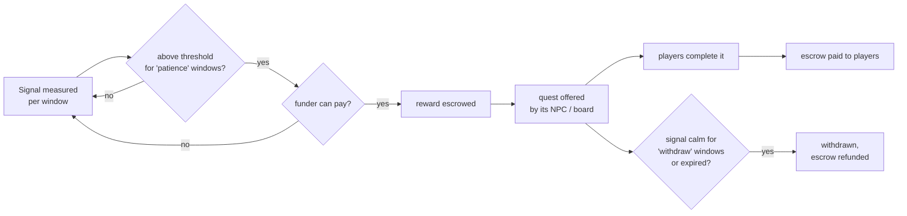

# World quests (planned)

Quests written in the editor that **the state of the world switches on and off**. Nothing is generated: the quest, its texts and its rewards are ordinary content with fixed ids ([D6](decisions.md)). What is new is *when* a quest is offered, *who pays* its reward and *when it is withdrawn*.

The first step is built: [server goals](content/characters.md#server-goals), one shared target over a counter that the gateway sums for every zone ([D68](decisions.md)).

The pattern comes from the Questless study (a persistent signal → patience → a funder escrows the reward → the quest is posted with its reason → it withdraws itself when the signal is gone), applied to the world instead of production. NPC shops already restock on their own, so supply quests are **not** a goal.

## The loop



## Content (all edited in the editor)

### `signals/<id>.ron`: something measured in the world

```ron
(
    measure: MonstersAlive(monster: "wolf", region: "north_trail"),
    window_secs: 300,        // measured once per window
    threshold: 12,           // "high" means >= 12 (Above) or <= 12 (Below)
    direction: Above,
    patience: 3,             // windows in a row before it counts
    gap_tolerance: 1,        // calm windows a streak survives
)
```

| `measure` (closed list, appended over time) | Feeds the example |
|---|---|
| `MonstersAlive(monster, region)` | "Clear the trail" |
| `PlayerDeaths(region)` per window | "Escort travellers", "Investigate" |
| `PlayersCrossing(region)` per window (low = abandoned route) | "Patrol the road" |
| `TownStat(town, stat)`: `Treasury`, `Legitimacy`, `GuardsUnpaid`, `TaxEvasion` | "Collect tribute", "Reinforce the guard" |
| `FactionStanding(faction, town)` | reconciliation quests |
| `EventActive(event)` | chains tied to an event |

Signals are **integers counted by the zones** and summed by the gateway (zones share no state, [D11](decisions.md)). A region that spans zones is summed across them.

### Quest fields added to `quests/<id>.ron`

```ron
(
    rank: E,
    objectives: [Kill(monster: "wolf", qty: 10, region: Some("north_trail")), Talk(npc: "guard_captain")],
    rewards: [Coins(300)],
    offer: World(
        when: Signal("wolves_north_trail"),    // any Condition, see below
        funder: Town("aurelia"),               // Town, Faction or Npc
        max_open: 1,                           // copies offered at once (per world)
        max_takers: 20,                        // players who may hold it at once
        expires_secs: 7200,
        withdraw_after: 2,                     // calm windows before withdrawal
    ),
)
```

- `offer: Always` (the default) keeps today's behaviour; existing quests do not change.
- **Rewards in `Coins` come from the funder's escrow**, never created. An unfunded quest is never shown. Item rewards stay as today (from content), unless a later `ItemsFrom(funder)` is added.
- A player who already accepted keeps the quest when it is withdrawn; a withdrawn quest only stops being offered.
- The reward may scale: `Coins(Scaled(base: 300, per_point_over: 20, max: 900))` pays more the worse the signal.

### Conditions, objectives and effects added (closed blocks, [D5](decisions.md))

| Kind | New variants |
|---|---|
| `Condition` | `Signal(id)`, `TownStat(town, stat, at_least/at_most)`, `FactionStanding(faction, at_least)`, `EventActive(event)`, `Law(town, law)` |
| `Objective` | `Kill(monster, qty, region?)`, `Reach(region)`, `Patrol(regions)` (visit in any order), `Escort(npc, to: region)` (later), `Donate(town, coins)` |
| `Effect` / `Reward` | `TownChange(town, stat, delta)`, `FactionChange(faction, delta)`, `StartEvent(event)` |

The same conditions work in dialogues, so an NPC can talk about the wolves only while the signal is high.

### `events/<id>.ron`: timed shocks

```ron
(
    duration_secs: 3600,
    effects: [SpawnBoost(monster: "bandit", region: "east_road", permille: 3000)],
    start: Manual,           // or Schedule(cron), or When(Condition)
)
```

From the editor a designer starts or stops an event live; quests with `EventActive` follow.

## Editor

| Screen | What the designer does |
|---|---|
| **Signals** | create a signal with pick lists (monster, region, town); see its **live value**, streak and a chart of the last day |
| **Quest → Offer** | choose `Always` or `World`; condition builder; funder pick list; a line "would be offered now: yes/no, because …" |
| **Events** | create, schedule, start / stop now |
| **World board** | every world quest: offered, waiting for funds, withdrawn; escrow held; who took it |

Validation: a `World` quest needs a funder that exists, `Coins` rewards within `max_takers × reward ≤` what the funder may escrow (warning), a signal used by at least one quest or dialogue (warning), regions and monsters that exist.

## Engine work

1. `defs`: `signals/`, `events/`, `offer`, new variants (appended), editor schemas.
2. `sim` (per zone): count signal measures per window; `Kill`, `Reach`, `Patrol` objectives.
3. `server` gateway: sum signals, streaks, offer/withdraw, escrow through the [town](towns-and-politics.md) accounts; push the offered list to zones.
4. Protocol: offered world quests in the quest board view; reason line (`quest.<id>.reason` text with the signal's value as a placeholder).
5. Telemetry: escrow and payouts as coin sources/sinks per funder.

See [towns and politics](towns-and-politics.md) for the funders.

## Decided

- Decided ([D55](decisions.md)): **both**: the quest's NPC offers it, and `offer.board: true` also lists it on the town's board object.
- Decided ([D55](decisions.md)): a kill counts for **every group member in sight** who has the objective.
- Decided ([D55](decisions.md)): content writes **seconds**; the engine converts to ticks (20/s) and numbers windows by tick, so `sim` stays deterministic.
